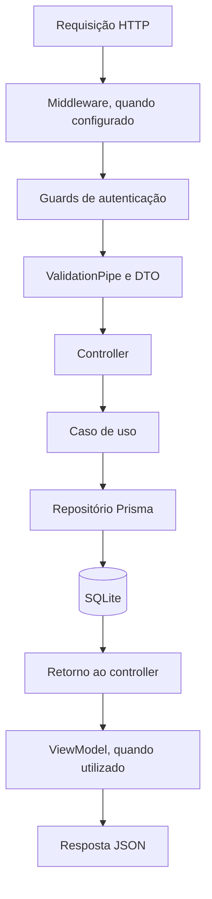

# YouTube Nest Notes

API de anotações pessoais construída com NestJS e TypeScript. Possui cadastro de usuários, autenticação por JWT e operações de criação, consulta, edição e exclusão de anotações.

Cada anotação pertence a um usuário. A listagem retorna apenas as anotações do usuário autenticado; as operações individuais verificam a propriedade da anotação.

## Tecnologias

- NestJS 12 com adaptador Express.
- TypeScript 6 e módulos ESM, com imports relativos terminados em `.js`.
- Prisma 7 com SQLite e o adaptador `better-sqlite3`.
- Passport com estratégias local e JWT.
- bcrypt para hash de senhas.
- class-validator e class-transformer para validação dos DTOs.
- Vitest para testes e Oxlint para análise estática.

## Executar localmente

Use Node.js compatível com as dependências instaladas, como a versão 24, e npm.

```bash
npm install
cp .env.example .env
```

Preencha as variáveis do `.env`:

```dotenv
DATABASE_URL=file:./prisma/dev.db
JWT_SECRET=substitua-por-um-segredo-aleatorio
JWT_EXPIRE=3600
```

| Variável | Finalidade |
| --- | --- |
| `DATABASE_URL` | Caminho do banco SQLite, utilizado pelo Prisma e pela aplicação. |
| `JWT_SECRET` | Segredo utilizado para assinar e verificar os tokens. |
| `JWT_EXPIRE` | Validade do token em segundos; quando definida, deve ser um inteiro positivo. |

O arquivo de configuração do Prisma tem o nome `prisma7.config.ts`, por isso os comandos abaixo informam seu caminho explicitamente.

```bash
npx prisma generate --config prisma7.config.ts
npx prisma migrate deploy --config prisma7.config.ts
```

Inicie o servidor carregando as variáveis de ambiente explicitamente:

```bash
NODE_OPTIONS='--env-file=.env' npm run start:dev
```

A API fica disponível em `http://localhost:3002`. A porta está definida em `src/main.ts`.

Para compilar e executar o resultado:

```bash
npm run build
node --env-file=.env dist/main.js
```

O comando de build também gera o Prisma Client por meio do script `prebuild`.

## Estrutura do projeto

```text
src/
├── main.ts                 # Inicialização e validação global
├── app.module.ts           # Módulo principal e guard JWT global
├── modules/
│   ├── user/               # Entidade, cadastro e contrato de repositório
│   ├── auth/               # Login, estratégias Passport e emissão de JWT
│   └── note/               # Entidade e casos de uso das anotações
├── infra/
│   ├── http/               # Controllers, módulos HTTP, DTOs e validação
│   └── database/           # Prisma, mapeadores e repositórios concretos
├── exceptions/             # Exceções compartilhadas e formato de erro
├── utils/                  # Utilitários e mapeamento de erros de validação
└── generated/prisma/       # Cliente gerado pelo Prisma
prisma/
├── schema.prisma           # Modelos do banco
└── migrations/             # Histórico de alterações do banco
```

Os arquivos `*.spec.ts` ficam próximos dos casos de uso. Os repositórios em memória permitem testar as regras sem acessar o SQLite.

## Como o NestJS trabalha neste projeto

O `main.ts` chama `NestFactory.create(AppModule)`. O Nest carrega os módulos, instancia os providers e conecta suas dependências. Em seguida, registra a validação global e inicia o servidor.

Os módulos agrupam responsabilidades:

- `AppModule`: importa os módulos da aplicação e registra o `JwtAuthGuard` como `APP_GUARD`.
- `UserModule`: registra o controller de usuários e o caso de uso de cadastro.
- `AuthModule`: configura JWT, estratégias de autenticação e middleware de validação do login.
- `NoteModule`: registra o controller e os casos de uso de anotações.
- `DatabaseModule`: conecta os contratos de repositório às implementações Prisma.

### Injeção de dependências

Um constructor declara o que a classe precisa receber:

```ts
constructor(private userRepository: UserRepository) {}
```

O `DatabaseModule` informa qual implementação o Nest deve fornecer:

```ts
{
  provide: UserRepository,
  useClass: PrismaUserRepository,
}
```

Com isso, o caso de uso trabalha com o contrato `UserRepository`. A implementação concreta recebe o `PrismaService` e executa as operações no banco.

### Fluxo de uma requisição



Os decorators `@Controller`, `@Get`, `@Post`, `@Put` e `@Delete` registram as rotas. `@Body`, `@Param` e `@Query` extraem dados da requisição; `@Request` permite acessar o usuário autenticado.

O controller encaminha os dados ao caso de uso. As regras, como impedir e-mails repetidos e verificar o dono de uma anotação, ficam nos casos de uso. Os ViewModels selecionam os campos enviados na resposta, evitando expor o hash da senha do usuário.

## Autenticação

O login utiliza `LocalAuthGuard` e `LocalStrategy`. A estratégia chama `ValidateUserUseCase`, que busca o usuário pelo e-mail e compara a senha com o hash usando bcrypt. O `SignInUseCase` emite o JWT.

Nas rotas protegidas, envie o token no cabeçalho:

```http
Authorization: Bearer SEU_TOKEN
```

O `JwtAuthGuard` verifica o token por meio da estratégia JWT. A identidade extraída fica disponível em `request.user`; os controllers de anotações usam `request.user.id` para identificar o proprietário.

**Estado atual do cadastro:** apenas `/signIn` está marcada com `@Public()`. Portanto, `POST /users` também exige JWT. Um banco vazio não permite realizar o fluxo inicial de cadastro e login somente pelas rotas atuais. Para permitir cadastro aberto, é necessário marcar essa rota como pública; esta documentação descreve o comportamento existente.

## Rotas

| Método | Rota | JWT | Operação |
| --- | --- | --- | --- |
| POST | `/users` | Sim | Cadastrar usuário. |
| POST | `/signIn` | Não | Autenticar e retornar `access_token`. |
| POST | `/notes` | Sim | Criar anotação. |
| GET | `/notes` | Sim | Listar anotações do usuário. |
| GET | `/notes/:id` | Sim | Consultar uma anotação. |
| PUT | `/notes/:id` | Sim | Editar uma anotação. |
| DELETE | `/notes/:id` | Sim | Excluir uma anotação. |

### Cadastro

Corpo de `POST /users`:

```json
{
  "name": "Vitor",
  "email": "vitor@example.com",
  "password": "123456"
}
```

O nome deve ser uma string não vazia, o e-mail deve ser válido e a senha deve ter pelo menos seis caracteres. O cadastro rejeita e-mails já existentes e armazena a senha como hash bcrypt. A resposta contém `id`, `name`, `email` e `createdAt`.

### Login

Com um usuário já cadastrado:

```bash
curl -X POST http://localhost:3002/signIn \
  -H 'Content-Type: application/json' \
  -d '{"email":"vitor@example.com","password":"123456"}'
```

Resposta:

```json
{
  "access_token": "TOKEN_JWT"
}
```

O corpo do login é validado pelo `SignInDTOValidateMiddleware` antes da autenticação local.

### Criar e editar anotações

Corpo de `POST /notes` ou `PUT /notes/:id`:

```json
{
  "title": "Estudar NestJS",
  "description": "Revisar módulos e injeção de dependências"
}
```

O título é obrigatório e não pode ser vazio. A descrição é opcional. Na edição, omitir a descrição define seu valor como `null`.

```bash
curl -X POST http://localhost:3002/notes \
  -H 'Authorization: Bearer SEU_TOKEN' \
  -H 'Content-Type: application/json' \
  -d '{"title":"Estudar NestJS","description":"Revisar módulos"}'
```

A criação e a consulta individual retornam `id`, `title`, `description` e `createdAt`.

### Listar anotações

```bash
curl 'http://localhost:3002/notes?page=1&perPage=20' \
  -H 'Authorization: Bearer SEU_TOKEN'
```

A resposta é um array de anotações. Os valores padrão são página `1` e `20` itens por página. Não há metadados de total na resposta, e a implementação atual não valida limites positivos ou um máximo de itens para esses parâmetros.

## Modelo de dados

| Entidade | Campos |
| --- | --- |
| `User` | `id`, `name`, `email` único, `password` e `createdAt`. |
| `Note` | `id`, `title`, `description` opcional, `createdAt` e `userId`. |

As entidades geram UUIDs e datas de criação quando esses valores não são fornecidos. Um usuário pode possuir várias anotações. A relação no banco utiliza exclusão em cascata: excluir um usuário no banco também exclui suas anotações. Não existe rota de exclusão de usuário no projeto atual.

## Validação e erros

O `ValidationPipe` global utiliza os decorators dos DTOs. As mensagens personalizadas ficam em `src/infra/http/classValidator`. O utilitário `mapperClassValidationErrorToAppException` seleciona a primeira mensagem de cada campo.

Exemplo de resposta de validação:

```json
{
  "message": "Dados inválidos",
  "fields": {
    "email": "O Campo email deve ser um email"
  }
}
```

As exceções da aplicação estendem `AppException`, que herda de `HttpException`. O Nest converte essas exceções em respostas HTTP.

| Situação | Status |
| --- | --- |
| Dados inválidos | `400` |
| E-mail ou senha incorretos | `401` |
| Token inválido ou expirado | `401` |
| Anotação de outro usuário | `401`, conforme implementação atual |
| Anotação não encontrada | `404` |
| E-mail já cadastrado | `409` |

## Testes e verificações

```bash
npm test              # Testes unitários com Vitest
npm run test:watch    # Testes em modo de observação
npm run test:cov      # Cobertura de testes
npm run lint         # Análise estática com Oxlint
npx tsc --noEmit      # Verificação de tipos
npm run build        # Geração do Prisma Client e compilação
```

Os testes cobrem cadastro, autenticação e operações de anotações usando repositórios em memória.

O comando `npm run test:e2e` utiliza `vitest.config.e2e.ts`. O teste existente ainda é o exemplo inicial que espera `GET /` com `Hello World!`; ele precisa ser atualizado para as rotas e a autenticação reais antes de servir como validação ponta a ponta da API.
